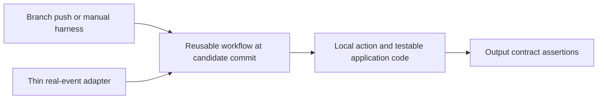

# Testing candidate workflows before merge

The useful question is not just "does this YAML run?" It is "which definition, code revision, event payload, permissions, and environment did this test actually exercise?"

## The recommended design



Keep trigger-specific logic small. Put orchestration shared by jobs into a reusable workflow, reusable steps into an action, and business logic into normal testable code. Do not copy the production workflow into a large parallel "test workflow" that will drift.

In this repository:

- [`branch-test.yml`](../.github/workflows/branch-test.yml) exercises the shared implementation through branch `push` and `workflow_dispatch`.
- [`event-adapter.yml`](../.github/workflows/event-adapter.yml) normalizes real `schedule` / `repository_dispatch` inputs.
- [`src/events.ts`](../src/events.ts) is tested with payload fixtures on a branch.
- [`plan.yml`](../.github/workflows/plan.yml) and the [root action](../action.yml) are the shared implementation.

Fixtures test your adapter code. They do not simulate GitHub's control plane.

## 1. For ordinary branch logic, use push

A `push` workflow in a feature branch can run the workflow definition in that pushed revision. It does not require a placeholder PR or a prior copy of that new file on `main`.

Use a branch-only harness, as this repository does. Make a candidate change, rebuild if needed, commit, and push:

```bash
git switch --create demo/workflow-change
# Edit the action or workflow, then:
npm run check
npm run check:dist
git add action.yml src scripts tests dist .github
git commit --message "Exercise the candidate action and workflow"
git push --set-upstream origin demo/workflow-change
gh run list --workflow branch-test.yml --branch demo/workflow-change
```

Only stage paths you actually intended to change. The sample command lists likely code paths; it is not an instruction to commit unrelated edits.

The branch harness is intentionally smaller than full PR CI. Run `ci.yml` manually against the branch when you want the entire suite without opening a PR:

```bash
gh workflow run ci.yml --ref demo/workflow-change
```

This does not exercise `pull_request` event semantics or dependency-review diffs. A real PR remains part of the normal merge lifecycle.

## 2. For repeatable branch experiments, use workflow_dispatch

Use a reviewed dispatch harness on the default branch as the registration/bootstrap path, then choose a candidate branch or tag:

```bash
gh workflow run branch-test.yml --ref demo/workflow-change --field version=2.3.4
gh run list --workflow branch-test.yml --branch demo/workflow-change --event workflow_dispatch
gh run view RUN_ID --log
```

The workflow must be recognized by GitHub and dispatch-enabled at the selected ref. The documented baseline is a workflow on the default branch; the UI's Run workflow button depends on that. Current GitHub documentation also describes dispatching a previously run workflow via the API/CLI on another branch. A new branch `push` harness avoids depending on registration edge cases.

`--ref` selects the workflow revision; it is not a user-defined checkout input. `repository_dispatch` has no equivalent workflow-ref selector. A payload field named `ref` does not change the workflow definition GitHub loads.

**Registration is the one-time bootstrap, not permission to merge every experimental change.** The registered harness can remain stable while candidate implementations change on branches.

## 3. Check out what you mean to test

Three references are easy to confuse:

| Reference | What it selects |
| --- | --- |
| Event / workflow ref | The workflow definition GitHub loads |
| `actions/checkout` ref | The repository files your steps see |
| Remote `uses: owner/repo/path@ref` | The version of that action or reusable workflow |

Changing checkout to a feature branch does **not** make GitHub load that branch's workflow YAML.

A local action (`uses: ./`) reads from the checked-out workspace. Check out before invoking it. This repository tests the checked-in bundle on real runners and compares a rebuild against the checked-in bundle so stale `dist/` cannot silently hide source changes. It does not override checkout to a different ref.

A relative reusable workflow (`uses: ./.github/workflows/plan.yml`) resolves from the same commit as its caller. It does not support an appended `@ref`. Job-level reusable `uses:` does not accept an expression such as `@${{ inputs.ref }}`.

Current GitHub.com also supports the recommended self-repository syntax (`uses: $/` and `uses: $/.github/workflows/plan.yml`). It resolves at the workflow's own commit rather than mutable filesystem state and supports GitHub's fully pinned policy. It requires runner 2.336.0 or newer. This starter retains `./` only because the pinned stable actionlint cannot yet validate `$/`; see the [bounded exception](validation.md#temporary-self-repository-syntax-exception) and [announcement](https://github.blog/changelog/2026-07-30-reference-same-repository-actions-with-self-repository-syntax/).

A remote reusable workflow can use a literal feature ref during controlled development, but pin its final consumer reference to a reviewed SHA. Remote reusable workflow execution does not automatically check out the callee repository: checkout normally refers to the caller's repository. The reusable workflow here is deliberately a same-repository example, not a drop-in cross-repository service.

## 4. Test PR integration with a real PR

`pull_request` normally tests GitHub's synthetic merge commit, not the head branch alone. That is useful evidence of compatibility with the target branch. Replacing checkout with `github.event.pull_request.head.sha` changes that evidence.

Test actual PR events for branch/path filters, labels, changed-file logic, required checks, and fork behavior. A real feature PR is not a workaround; it is the integration test for that event. Do not create fake PRs just to run unrelated schedule logic.

Use `merge_group: checks_requested` on required workflows if enabling a merge queue. A successful PR run is not a merge-group result. Include the relevant merge-group base/head refs in dependency review too.

## 5. For default-branch events, use two kinds of evidence

For `schedule`, `repository_dispatch`, `issue_comment`, and other default-branch events:

1. Test business logic and input normalization on the candidate branch with fixtures, unit tests, and the branch harness.
2. Test actual event delivery and context in a **separate disposable sandbox repository**, where the candidate can be its default branch.
3. Promote the reviewed change normally. Run a harmless post-merge canary for the real event and record the resulting SHA and output.

Creating a sandbox repo is an explicit test-environment action. Do not change a production repository's default branch just to make an event fire. A sandbox is lower fidelity for organization policy, permissions, environments, and installed apps; reproduce those controls deliberately when they matter.

The adapter in this repository accepts a `preview-plan` dispatch with a version string. It ignores payload-supplied targets and refs. To test the real adapter in your copy:

```bash
gh api --method POST "repos/OWNER/REPO/dispatches" \
  --field event_type=preview-plan \
  --field 'client_payload[version]=2.3.4'
gh run list --workflow event-adapter.yml --event repository_dispatch
```

Replace `OWNER/REPO` with your sandbox or your authorized copy. This runs the default-branch adapter, not candidate workflow YAML from an arbitrary branch.

## 6. Keep test and deployment authority separate

A branch author can change a workflow to ignore a `dry-run` input. Therefore `dry-run: true` is not a security boundary.

This harness has no deployment steps, secrets, write token, production environment, or cloud identity. For a real deployer, use a separate sandbox identity with restricted resource scope and OIDC trust. Protect production environments and bind cloud trust to approved repositories, refs, and environments. An environment approval is not a substitute for reviewing the exact code that will receive credentials.

Do not use `pull_request_target` or a privileged `workflow_run` job to check out and execute untrusted PR code. Their elevated context can expose secrets, write tokens, cache scopes, or runners. See the [event matrix](event-matrix.md).

## 7. Know what local emulation cannot prove

[`act`](https://nektosact.com/) can shorten the edit/run loop for supported workflows. It is optional, not a required gate here. Run only trusted workflows, with no production secrets or ambient cloud credentials; Docker access is powerful.

Local success is not parity for hosted runner images, token permissions, OIDC claims, environments, reusable workflow behavior, caches, artifacts, approvals, concurrency, or event routing. Consult the [documented unsupported functionality](https://nektosact.com/not_supported.html). Keep native GitHub runs as the acceptance evidence.

## Evidence to attach to a review

Record the run URL, event name, workflow ref/SHA, checkout SHA, expected and observed outputs, credential scope, and any untested event behavior. The reusable workflow writes execution identity into the run summary. A green run on a moving branch is not durable evidence for a different commit.
